<div align="center">

  

</div>

<div align="center">

  <p>
    <a href="https://narainkarthikv.com"></a>
    <a href="https://ko-fi.com/wisdom-fox"></a>
    <a href="https://www.buymeacoffee.com/narainkarthikv"></a>
    <!-- <a href="https://discord.gg/cb6tqTfk"></a> -->
    <a href="https://www.linkedin.com/in/narainkarthik-vellingiri/"></a>
    <a href="https://www.gitlab.com/narainkarthikv"></a>
  </p>

  
  

</div>

### 🚀 Quick Bio


```js
const wisdomFox = {
  title: '👨‍💻 Full Stack Developer | Cloud & DevOps Enthusiast',
  location: '🌏 Digital Nomad',
  passions: ['💻 Web Dev', '🎨 UI/UX', '☁️ Cloud', '⚙️ DevOps'],
  hobbies: ['🔧 Electronics', '🎬 Video Editing', '🎮 Gaming', '📚 Reading'],
  currentFocus: '🚀 Building delightful web experiences',
  funFact: '🐧 Linux excites me more than Windows!',
};
```

### 👤 About Me


- 🌍 **Digital Nomad**: On a mission to make the web a more delightful place
- 🎨 **UI Craftsman**: Crafting sleek user interfaces with passion
- ☁️ **Cloud Automator**: Streamlining workflows and building scalable solutions
- 🔧 **Electronics Tinkerer**: Exploring hardware and bringing creativity to
  tech
- 🧠 **Lifelong Learner**: Embracing curiosity, clarity, and continuous growth

<br clear="both" />

### 🤓 Fun Facts & Quirks



- 🦊 Curious by nature; stubborn about my tech choices
- 🧑‍🍳 Ramen cooking + code shipping = my kind of multitasking
- 🏆 Build → break → learn. I’m cool with looking silly
- ⚡ Coffee + debugging = locked in, with zero chill
- 🐧 Linux > Windows. It just feels right
- 🎮 Games taught me to stay curious and try a new route.

<br clear="both" />

### 💻 Tech Arsenal


<table border="0" cellpadding="8" cellspacing="0" width="100%">
  <tr>
    <td valign="top" width="25%" align="center">
      <h3>💻 Languages &amp; Markup</h3>
      
    </td>
    <td valign="top" width="25%" align="center">
      <h3>🎨 Frontend &amp; UI</h3>
      
    </td>
    <td valign="top" width="25%" align="center">
      <h3>⚡ Backend &amp; APIs</h3>
      
    </td>
    <td valign="top" width="25%" align="center">
      <h3>☁️ Cloud &amp; Databases</h3>
      
    </td>
  </tr>
  <tr>
    <td valign="top" width="25%" align="center">
      <h3>🔄 Source Control &amp; CI/CD</h3>
      
    </td>
    <td valign="top" width="25%" align="center">
      <h3>📦 Containers &amp; OS</h3>
      
    </td>
    <td valign="top" width="25%" align="center">
      <h3>🤖 AI Developer Tools</h3>
      
    </td>
    <td valign="top" width="25%" align="center">
      <h3>🧩 Product &amp; Collaboration</h3>
      
    </td>
  </tr>
</table>

<!-- ## ♥️✨ Coding & Chilling

<div align="center">

<p>
<a href="https://leetcode.com/Narainkarthik31/"></a>
<a href="https://www.geeksforgeeks.org/user/narainkarthik812/"></a>
<a href="https://steamcommunity.com/profiles/76561199130656975/"></a>
<a href="https://open.spotify.com/user/31kjez2sc5umwskdatczxceb3xdi"></a>
</p>

</div>

--- -->

### 🌟 Featured Projects


```text
PROJECT INDEX // 05 ENTRIES
```

<table border="0" cellpadding="10" cellspacing="0" width="100%">
  <tr>
    <th align="left" width="8%">ID</th>
    <th align="left" width="20%">PREVIEW</th>
    <th align="left" width="72%">PROJECT // CLASSIFICATION // OVERVIEW</th>
  </tr>
  <tr>
    <td valign="middle"><code>01</code></td>
    <td valign="middle" align="center"></td>
    <td valign="middle">
      <strong><a href="https://fitprogressr.netlify.app/">FitProgressr</a></strong> &nbsp; <code>FULL-STACK // FITNESS</code><br />
      🏋️ Full-stack <strong>MERN fitness tracker</strong> with responsive dashboards, streak analytics,
      and custom routine management for performance-focused workout tracking.
    </td>
  </tr>
  <tr>
    <td valign="middle"><code>02</code></td>
    <td valign="middle" align="center"></td>
    <td valign="middle">
      <strong><a href="https://ownlyst.netlify.app/">Ownlyst</a></strong> &nbsp; <code>PRODUCTIVITY // OFFLINE-FIRST</code><br />
      📝 Privacy-first <strong>note-taking app</strong> with offline storage, multiple view modes, and
      zero server dependency for distraction-free productivity.
    </td>
  </tr>
  <tr>
    <td valign="middle"><code>03</code></td>
    <td valign="middle" align="center"></td>
    <td valign="middle">
      <strong><a href="https://nmoji.netlify.app/">Nmoji</a></strong> &nbsp; <code>ASTRO + REACT // EMOJI SEARCH</code><br />
      😀 Emoji search and picker built with <strong>Astro + React</strong>, optimized for instant
      filtering, keyboard-first navigation, and extension-ready performance.
    </td>
  </tr>
  <tr>
    <td valign="middle"><code>04</code></td>
    <td valign="middle" align="center"></td>
    <td valign="middle">
      <strong><a href="https://contribution-cards.netlify.app/">Contribution Cards</a></strong> &nbsp; <code>GITHUB // CONTRIBUTOR DIRECTORY</code><br />
      👥 GitHub contributor directory with <strong>smart caching</strong>, filtering, and profile
      surfacing without requiring a backend service.
    </td>
  </tr>
  <tr>
    <td valign="middle"><code>05</code></td>
    <td valign="middle" align="center"></td>
    <td valign="middle">
      <strong><a href="https://markdownshop.netlify.app/">Markdown Shop</a></strong> &nbsp; <code>MARKDOWN // DOCUMENTATION TOOLING</code><br />
      📄 Interactive <strong>README builder</strong> with live Markdown preview, reusable templates,
      and badge components for faster developer documentation.
    </td>
  </tr>
</table>

### 📊 GitHub Activity


<div align="center">

  

  

  

  

</div>



